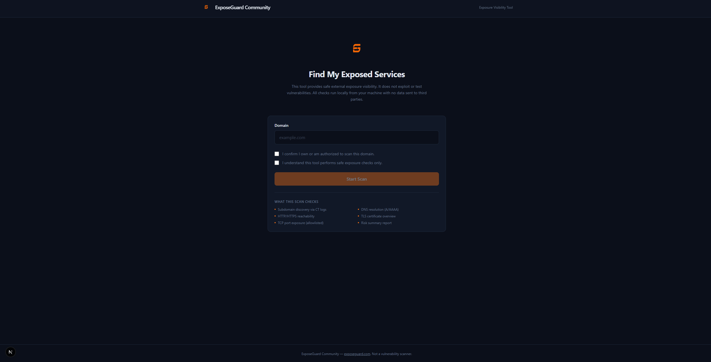
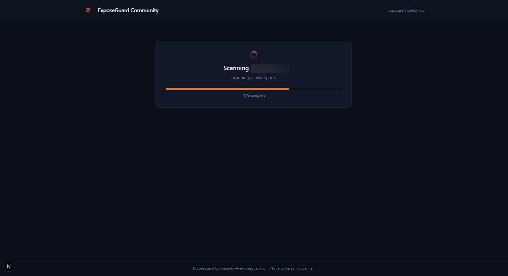
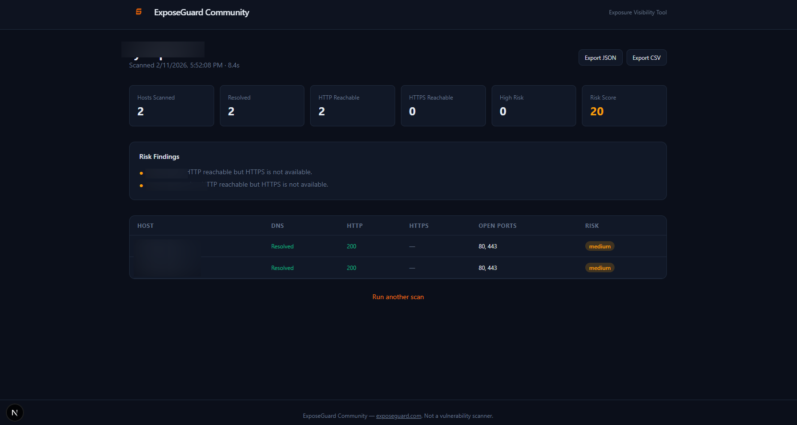

<p align="center">
  
</p>

<h1 align="center">ExposeGuard Community Edition</h1>

<p align="center">
  <strong>Find your exposed services before someone else does.</strong>
</p>

<p align="center">
  Safe, local-only external exposure visibility for your domains.<br/>
  No agents. No cloud. No database. Runs entirely on your machine.
</p>

<p align="center">
  <a href="https://exposeguard.com">exposeguard.com</a> &nbsp;&middot;&nbsp;
  <a href="#quickstart">Quickstart</a> &nbsp;&middot;&nbsp;
  <a href="#how-it-works">How It Works</a> &nbsp;&middot;&nbsp;
  <a href="#safety--constraints">Safety</a>
</p>

---

## Overview

ExposeGuard Community Edition discovers subdomains, checks service reachability, inspects TLS certificates, and identifies risky exposed ports across your domain — all through passive reconnaissance and safe TCP connect checks.

Enter a domain, confirm ownership, and get a full exposure report in under two minutes.

### What it does

- **Subdomain Discovery** — Pulls subdomains from Certificate Transparency logs via crt.sh
- **DNS Resolution** — Resolves A and AAAA records, blocks private/internal IPs from being scanned
- **HTTP/HTTPS Checks** — Tests reachability with HEAD fallback to GET, captures status codes and server headers
- **TLS Certificate Inspection** — Extracts issuer, expiration date, and flags certificates expiring within 14 days
- **TCP Port Scanning** — Tests 21 commonly exposed ports via simple TCP connect (see [full port list](#scanned-ports))
- **Risk Scoring** — Weighted scoring model with categorized findings and plain-English explanations
- **Export** — Download results as JSON or CSV

### What it does NOT do

- Exploit or test for vulnerabilities
- Perform banner grabbing or protocol negotiation
- Attempt authentication, brute-force, or password spraying
- Use nmap, masscan, or any aggressive scanning tool
- Store data persistently — everything is in-memory, gone on restart
- Send your data anywhere — the only external call is to crt.sh for CT log queries

---

## Quickstart

### Docker

```bash
docker compose up
```

Open **http://localhost:3000** and start scanning.

### Manual Setup

Requires **Node.js 24+** (current LTS).

```bash
npm install
cp .env.example .env
npm run dev
```

Open **http://localhost:3000**.

### Production

```bash
npm run build
npm start
```

### Development checks

```bash
npm run lint
npm run typecheck
npm test
```

CI runs these plus `npm audit`, a production build, and a Docker image smoke test on every pull request. Dependabot opens weekly update PRs for npm packages, GitHub Actions, and the Docker base image.

---

## How It Works

```
Domain Input
    │
    ▼
┌─────────────────────┐
│  CT Log Discovery    │  Passive subdomain enumeration via crt.sh
│  (crt.sh)           │  Wildcards filtered, deduped, capped at 50 hosts
└─────────┬───────────┘
          │
          ▼
┌─────────────────────┐
│  DNS Resolution      │  A + AAAA records
│                      │  Private / reserved IPs blocked (see Safety below)
└─────────┬───────────┘
          │
          ▼
┌─────────────────────┐
│  HTTP/HTTPS Checks   │  HEAD → GET fallback, 5s timeout, 3 redirects max,
│                      │  each redirect hop re-validated; pinned to vetted IPs
│  TLS Inspection      │  Issuer, expiry, days remaining
└─────────┬───────────┘
          │
          ▼
┌─────────────────────┐
│  TCP Port Checks     │  21 allowlisted ports, connect-only
│                      │  1s timeout per port, 20 concurrent max
└─────────┬───────────┘
          │
          ▼
┌─────────────────────┐
│  Risk Scoring        │  Weighted model → 0–100 score
│  Report Generation   │  JSON + CSV export
└─────────────────────┘
```

---

## Safety & Constraints

| Constraint | Detail |
|---|---|
| Ownership consent | Required before every scan |
| Blocked TLDs | `.gov`, `.mil` |
| Private IP blocking | All IANA special-purpose ranges: RFC1918, loopback, link-local (incl. cloud metadata), CGNAT, multicast, reserved, IPv6 ULA/link-local, and IPv6 forms that embed IPv4 (mapped, NAT64, 6to4) |
| SSRF protection | Connections are pinned to the validated IPs (no re-resolution), and every HTTP redirect hop is re-validated |
| Host cap | 50 per scan |
| Scan timeout | 2 minutes hard limit; hosts not reached in time are flagged and partial results are returned |
| Concurrency | Up to 10 hosts scanned in parallel; at most 3 scans running at once |
| Rate limit | 5 scans per hour per client IP, 30 per hour per server |
| Port behavior | TCP connect only — no payload, no banner grab, no auth |
| Port timeout | 800–1200ms per connection |
| No persistence | All data in-memory, nothing written to disk; results expire after 1 hour |

---

## Risk Scoring

The scoring model is deterministic and explainable. Every finding maps to a fixed point value.

| Finding | Severity | Points |
|---|---|---|
| RDP (3389) reachable | High | 20 |
| SMB (445) reachable | High | 15 |
| Database port reachable (1433, 3306, 5432, 27017, 6379) | High | 15 each |
| HTTP reachable but HTTPS not available | Medium | 10 |
| TLS certificate expires in < 14 days | Medium | 8 |
| More than 20 externally visible subdomains | Low | 5 |

Score is capped at 100. Every finding includes a human-readable explanation.

---

## Scanned Ports

| Port | Service | | Port | Service |
|---:|---|---|---:|---|
| 21 | FTP | | 993 | IMAPS |
| 22 | SSH | | 995 | POP3S |
| 25 | SMTP | | 1433 | MSSQL |
| 53 | DNS | | 1521 | Oracle |
| 80 | HTTP | | 3306 | MySQL |
| 110 | POP3 | | 3389 | RDP |
| 143 | IMAP | | 5432 | PostgreSQL |
| 443 | HTTPS | | 6379 | Redis |
| 445 | SMB | | 8080 | HTTP-Alt |
| 587 | SMTP/TLS | | 8443 | HTTPS-Alt |
| | | | 27017 | MongoDB |

---

## Configuration

| Variable | Default | Description |
|---|---|---|
| `LOGGING_ENABLED` | `true` | Toggles scan event logging to stdout. Logs include timestamp, domain, duration, and host count. No IP addresses are logged. |
| `TRUSTED_PROXY_HOPS` | `1` | Number of reverse proxies in front of the app that append to `X-Forwarded-For`. The client IP for rate limiting is taken that many entries from the right. |

> **Exposing the app publicly:** put it behind a reverse proxy that sets `X-Forwarded-For`. Without one, the header is client-controlled, so per-IP rate limits can be evaded (the per-server limit still applies). Terminate TLS and set HSTS at the proxy.

---

## Project Structure

```
src/
├── app/
│   ├── api/scan/              POST /api/scan — start a scan
│   │   └── status/            GET /api/scan/status?id= — poll progress & results
│   ├── api/health/            GET /api/health — container healthcheck
│   ├── results/page.tsx       Results view with live polling
│   ├── page.tsx               Landing page with scan form
│   ├── layout.tsx             Shell layout (header, footer)
│   └── globals.css            Theme variables and base styles
└── lib/
    ├── scanner/
    │   ├── types.ts           Shared TypeScript interfaces
    │   ├── orchestrator.ts    Scan lifecycle and job store
    │   ├── ct-discovery.ts    Certificate Transparency lookup
    │   ├── dns-resolver.ts    DNS resolution + private IP filtering
    │   ├── http-checker.ts    HTTP/HTTPS reachability
    │   ├── tls-checker.ts     TLS certificate extraction
    │   ├── port-scanner.ts    TCP connect port checks
    │   ├── risk-scorer.ts     Risk calculation engine
    │   └── logger.ts          Stdout logger
    └── utils/
        ├── validation.ts      Domain input validation
        ├── ip-filter.ts       Private/reserved IP detection
        ├── pinned-lookup.ts   Pins connections to validated IPs
        ├── rate-limit.ts      In-memory rate limiter
        └── export.ts          JSON and CSV generation
```

---

## Tech Stack

- **Next.js 16** — App Router with Node.js runtime API routes
- **React 19** — Client-side UI
- **TypeScript 5** — End-to-end type safety
- **Tailwind CSS 4** — Styling
- **Docker** — Single-command deployment

No database. No external APIs (besides crt.sh). No paid services.

---

## Legal Notice

This tool is provided for **authorized security assessments only**. By using ExposeGuard, you confirm you have explicit authorization to scan the target domain. Unauthorized scanning of systems you do not own or have written permission to test may violate applicable laws. The authors and contributors assume no liability for misuse of this tool.

---

## Screenshots

### Landing Page
Enter a domain and confirm authorization to begin a scan.



### Scan Progress
Real-time progress tracking as ExposeGuard works through each check.



### Results
Summary cards, risk findings, and a detailed host table with expandable rows.



---

<p align="center">
  <a href="https://exposeguard.com">exposeguard.com</a>
</p>

## License

MIT
